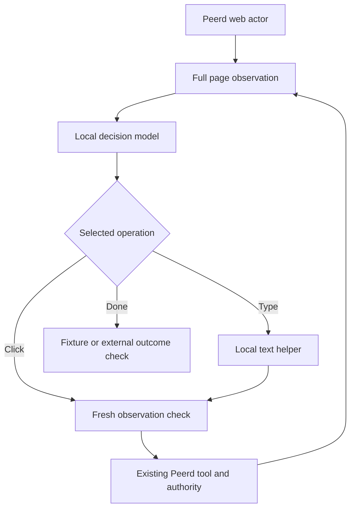

# Local browser decision prototype

## Recommendation

Build the first demo around a small decision model choosing from observed page
actions, with a small local language model supplying field values and explaining
results. Peerd should continue to own the browser, permissions, cancellation,
and outcome evidence. Extend its existing site clients for repeated work.

The practical starting pair is **Decider-4B v3 Q4_K_M + Qwen3.5-2B Q4_K_M**.
Their published downloads are approximately 2.7 GB and 1.9 GB respectively.
That makes a 16 GB Apple Silicon machine a plausible target, not a measured
memory or speed result. Browser processes, macOS, model workspaces, context
caches, and other applications also consume unified memory. See the
[Decider checkpoint](https://huggingface.co/Mapika/decider-4b-GGUF) and
[exact Qwen Ollama tag](https://ollama.com/library/qwen3.5:2b-q4_K_M).

The strongest small browser-specific accuracy challenger found in this review
is **AIMultiple's Kev-9B browser fine-tune**: 32/50 completed tasks versus 21/50
for its paired stock run. Those were single attempts on an H100 with FP32
reference kernels, an 8k input limit, and Jev's operation-and-target question
format. False completion rose from four to seven cases; the fine-tune's
probabilities are explicitly uncalibrated. The released adapter and pointer
head are useful, but there is no verified 4-bit Mac package of this checkpoint
in the reviewed sources. The result does not transfer automatically to a new
quantization or this prototype's joint-action question. Sources:
[fine-tune](https://huggingface.co/AIMultiple/kev-9b-browser-ft),
[Kev runtime](https://github.com/jaredpalmer/kev).

This directory is an opt-in development experiment. Its scripts do not ship
inside the extension. They make no cloud inference fallback and do not control
the browser directly. Local inference eliminates per-call API charges; websites
still require their normal network access, and downloading the weights is an
initial network operation.

## What the Peerd review found

The review started from main commit
`dbf9208202d848d06c464a6221a2920952082dfd`. The following are architectural
findings; the linked code remains authoritative as the project changes.

| Area | Existing foundation and implication |
| --- | --- |
| Browser ownership | Isolated actors execute through host-owned tab and origin authority. A decision process can remain outside that boundary and return the existing tool protocol. See [kernel authority](../../extension/background/kernel-turn-authority-adapter.js). |
| Observation | Accessibility-tree and DOM-walk snapshots both expose opaque element refs. This is a useful substrate for bounded action classification. See [DOM surface](../../extension/peerd-runtime/dom/index.js) and its serializers. |
| Action surfaces | The web actor supports discrete tools and a code surface. This experiment explicitly requires the discrete tools. It returns no selectors or executable page code. |
| Local inference | [Ollama](../../extension/peerd-provider/adapters/ollama.js) and [WebGPU](../../extension/peerd-provider/adapters/local-webgpu.js) adapters already exist. A decision model's custom head is a separate runtime concern; treating its weights as an ordinary chat model would be incorrect. |
| Model routing defect | The production actor minting path ignored the configured web actor model. This branch applies an explicit pin to tab-backed web actors and remints a binding when the pin changes or clears. API and engine actors retain the owner's model. Automatic cross-provider selection remains separate work. |
| Repeated work | [Site clients](../../extension/peerd-runtime/site-clients/index.js) already support reusable, origin-bound operations. Preserve this implementation and its credential/permission checks when adding learned workflows. |
| Evaluation | The existing Online-Mind2Web trajectory/export path is reusable. This branch allows keyless Ollama configuration and explicitly disables model interception in real runs. A successful wire fixture is not a successful model benchmark. |
| Freshness gap | The [ref registry](../../extension/peerd-runtime/dom/ref-registry.js) increments snapshot generation, but dispatch does not require that generation. A later snapshot can assign a familiar ref to another element. Production action receipts should bind document identity and observation generation through final dispatch. |
| Coverage gaps | Current discrete controls do not cover all hover, drag, scroll, keyboard, visual-only, or cross-frame interactions. DOM-walk event synthesis can also differ from trusted browser input. Keep the initial task distribution within verified coverage. |

The prototype's second snapshot reduces inference-time stale actions. It is
**not an atomic guarantee** against a DOM mutation after verification and before
the host dispatches the action. That remaining race belongs in the browser host,
not in a model prompt.

## Benchmark interpretation

The review checked primary model cards, code, and benchmark artifacts on
2026-10-26. These are historical observations, not a live leaderboard.

| Evidence | Useful conclusion | What it does not establish |
| --- | --- | --- |
| [AIM browser evaluation](https://aimultiple.com/decision-models) and [raw dataset](https://huggingface.co/datasets/AIMultiple/aimultiple-decision-models-browser) | In the original comparison, Lux-9B completed 22/50, Decider-4B 19/50, and Clef-Flash 16/50. Runs used the same hosted Mercury helper and browser harness. | The evaluated Decider checkpoint predates the selected v3 GGUF. These are not measurements of this all-local pair. The later Kev fine-tune result above is a separate paired experiment. |
| [WebJev](https://github.com/lexmount/WebJev) | Browser adaptation mattered: 47/122 gradable tasks versus 20/120 for Jev-1.13, despite similar generic decision scores. | The selected task subset is not the full source benchmarks. Its roughly 35B total parameters do not fit a 16 GB machine simply because only about 3B are active. |
| [Jev ultrafast](https://github.com/browser-use/jev-ultrafast) | A decision model plus a text helper can reduce sequential text generation during control. | A reported 7.073-second flight flow is a narrow hosted-model experiment, with setup and verification outside the reported task timing. It is not Mac throughput or broad success evidence. |
| [Clef-Flash MLX](https://huggingface.co/mlx-community/clef-flash-4bit) | A custom decision head can run in a local MLX server. Its card reports roughly 7.2 GB at a 4k input on a much larger M5 Max machine. | The remaining memory margin and latency on a 16 GB MacBook need measurement. Standard chat serving is not a substitute for the custom head. |
| [Fara-1.5](https://arxiv.org/html/2606.20785v2) | A small visual browser model is a credible comparison: the paper reports 80.8% WebVoyager and 57.3% Online-Mind2Web. | Different harnesses and budgets prevent ranking it directly against AIM's table. The reported scores are not 4-bit Mac measurements, and Peerd needs an appropriate visual action surface. |
| [Decision Index](https://huggingface.co/datasets/multimodalart/decision-index-leaderboard) | Useful for locating candidate decision models and checking released artifacts. | Generic classification accuracy does not rank closed-loop browser reliability. |

Keep offline Mind2Web, live Online-Mind2Web, screenshot grounding, WebArena,
and BrowserGym results separate. Grounding accuracy measures target selection;
a browser task can still fail through text entry, state tracking, navigation,
termination, or outcome verification. BrowserGym is an evaluation environment,
not a single interchangeable score.

The linked [Aaron Epstein post](https://x.com/aaron_epstein/status/2114509061890998717)
points toward Pomerado's reusable-API angle. Direct post retrieval was incomplete,
so this review makes no engagement-count claim. Pomerado's own
[comparison](https://pomerado.ai/) uses pre-created APIs and token-cost accounting.
Treat that as evidence for amortizing repeated interactions; include discovery,
validation, repair, and elapsed time in Peerd's comparison. A first-run browser
agent and a pre-built API are different starting conditions.

## How the prototype works



[decision-core.mjs](decision-core.mjs) accepts a complete canonical snapshot and
constructs fully bound choices such as clicking a particular observed button
or typing into a particular observed field. Disabled elements are excluded.
Duplicate, phantom, ambiguous, truncated, and differential refs fail closed.
Oversized candidate sets or requests are refused rather than silently dropping
part of the page. This parser is deliberately conservative; it is not a complete
semantic prompt-injection defense.

[model-bridge.mjs](model-bridge.mjs) asks the decision server to select a choice.
Only text-entry decisions call the field helper. The chosen action and text are
held until a second full snapshot agrees. The pending decision also belongs to
one transcript and user goal; later instructions cannot release an old click.
Reads become evidence for the next decision and are invalidated by subsequent
mutations. A reused actor begins a new evidence episode for each new goal.

Initial navigation uses an explicit URL already present in the user goal.
Subsequent destinations come from observed links. The decision process does not
invent a URL, selector, target ref, or browser script. Existing Peerd origin,
permission, cancellation, and tab-ownership checks still run on every action.
The policy's DONE choice is only a completion claim. It is never the test judge.

[serve.mjs](serve.mjs) presents an Ollama-compatible model wire to Peerd and
forwards inference only to literal loopback endpoints. It rejects redirects,
unconfigured browser origins, invalid hosts, concurrent work, and oversized
requests. It exposes a helper model and a separate virtual browser model.
Native Ollama requests use an explicit effective helper context and disable
thinking. Both helper uses share that context to avoid repeated runner reloads.

The virtual model retains a larger CPU-side conversation than the actual
decision model receives. This avoids Peerd compacting a modest verification
exchange between its two snapshots. The actual decision input remains separately
bounded and token-checked. Very long conversations can still reach compaction;
a changed pending transcript is refused. The constants and budgets live in the
source, not in this guide.

[serve_decider.py](serve_decider.py) loads one fixed GGUF and exposes System One
on loopback. Requests cannot load arbitrary models. It checks the full rendered
decision prompt against the configured context before invoking the reviewed
runtime, rather than allowing silent prompt truncation. Native inference may
continue briefly after its HTTP caller cancels; cancellation prevents later
browser dispatch, and the backend lock prevents concurrent model execution.

## Run on an Apple Silicon Mac

Use a clean development checkout and a separate test browser profile. Follow
Peerd's normal unpacked-extension setup; regenerate development files with
`bun run gen:dev`. Use native arm64 Python 3.11 or later. Install Bun, Node,
Python, Ollama, and Apple's command-line
build tools through their normal installation paths if they are not present.

### 1. Prepare the decision runtime

The reviewed runtime commit and checkpoint revision are pinned here for
reproducibility. Use a virtual environment:

```sh
python3 -m venv scripts/local-browser/.venv
source scripts/local-browser/.venv/bin/activate
python -m pip install --upgrade pip
CMAKE_ARGS="-DGGML_METAL=on" python -m pip install \
  'decider-ai[gguf] @ git+https://github.com/Mapika/decider.git@91b6fa9b94ab6c4dc2c63d3b14d413243b4fffcc'
python scripts/local-browser/serve_decider.py \
  --revision=d3a78581751d518bbfa9e871a6d84059554d53c5
```

The GGUF filename is fixed by the adapter default. Use `--help` for context,
checkpoint-directory, and port options. Initial startup downloads the selected
weights; subsequent starts reuse the local cache. `/health` reports whether the
decision model is actually loaded. The bridge's own health response only means
the bridge is listening; it does not certify model readiness.

### 2. Run the helper on its own loopback port

The bridge occupies Ollama's usual port so the extension's existing development
connection policy can be used. Start a separate Ollama daemon in another shell:

```sh
OLLAMA_HOST=127.0.0.1:11436 ollama serve
```

In another shell, pull the explicit quantization:

```sh
OLLAMA_HOST=127.0.0.1:11436 ollama pull qwen3.5:2b-q4_K_M
```

Keep the explicit tag: a moving `2b` alias can select a larger quantization.
Stop or move any existing daemon occupying the bridge port using its normal
application controls. The scripts do not kill other processes or reconfigure
an existing Ollama installation.

### 3. Connect the bridge to Peerd

Read the unpacked extension's actual ID from `chrome://extensions`. Substitute
that ID for `EXTENSION_ID` below; the allowlist accepts an exact extension origin.

```sh
node scripts/local-browser/serve.mjs \
  --extension-origin=chrome-extension://EXTENSION_ID
```

In Peerd's provider settings, choose Ollama with host
`http://127.0.0.1:11434`, select `qwen3.5:2b-q4_K_M` for the main chat, and set
**Web actor model** to `peerd-local-browser`. In behavior settings select the
web actor's **tools** surface. Start a fresh chat and grant the ordinary Act
permissions appropriate to the task. The explicit web actor pin is important;
the virtual model's transcript window is intended for the browser policy.

Try a short, reversible task with an explicit starting URL and an independently
checkable result. Keep one task active. The small helper's ability to handle
Peerd's general orchestration prompt remains part of the real-model evaluation;
a dedicated browser entry flow with a compact delegation prompt is a worthwhile
next optimization.

## Verification and evidence

Run the focused checks from the repository root:

```sh
bun test tests/local-browser tests/eval/om2w-provider-config.test.ts \
  tests/background/kernel-turn-authority-adapter.test.ts
python3 -m unittest discover -s scripts/local-browser -p 'test_*.py'
bun run typecheck
bun scripts/local-browser/run-smoke.mjs
```

For the browser smoke, first install the repository's pinned Chrome for Testing
with `bun run e2e:chrome`, or set `CHROME_PATH` to a compatible Chrome for Testing
binary. The launcher does not install Chrome automatically; a regular branded
Chrome installation is not an equivalent unpacked-extension test environment.

The smoke runner launches real Chrome and the unpacked extension against owned
fixture pages, with browser web security enabled. Its two scenarios exercise
search/type/click/navigation and a DOM change during inference that moves refs
and inserts a decoy. It checks final URL, visible DOM, and actual page event
receipts independently of the model's terminal message. Its JSON report is
written beneath the existing ignored CDP artifacts directory.

The runner's evidence class is **scripted-model-real-browser**. Read `ok`, each
check, errors, and navigation evidence in the report; the presence of the script
is not a passing result. Model responses are scripted to isolate integration.
Pure tests additionally cover altered transcripts, later user instructions,
cancellation, malformed snapshots, context boundaries, transport constraints,
and invalid model answers. Neither test type measures model accuracy or Mac
performance. Record any real-weight probe separately with its exact hardware,
checkpoint, runtime, input, and output.

An actual CPU inference record is committed at
[evidence/linux-decider-probe.json](evidence/linux-decider-probe.json). It records
the checkpoint and runtime hashes, expected and returned action, real token
counts, elapsed time, and process memory. The observation was synthetic; no
browser or text helper participated in that probe. To repeat it against an
already running decision server:

```sh
node scripts/local-browser/run-probe.mjs
```

To exercise the real decision server inside the same browser fixtures:

```sh
bun scripts/local-browser/run-smoke.mjs --decision-origin=http://127.0.0.1:8000
```

That mode writes a separate `mixed-result.json` with evidence class
**real-decision-scripted-helper-real-browser**. Its decision responses come from
the local weights unchanged; delegation and the field text remain scripted.
It tests the real decision policy inside the browser, while keeping the full
two-model system and Mac performance as separate validation work.
The recorded scripted and real-decision fixture outcomes, timings, and checks
are preserved in [evidence/linux-browser-fixtures.json](evidence/linux-browser-fixtures.json).

The corrected Online-Mind2Web driver can use a real keyless local endpoint.
Use the flags documented in its source and the normal dataset preparation flow. Select the
helper as the chat model and the bridge as the runner model for the split arm.
Explicit smoke mode is the only driver path allowed to install a scripted
model responder. The optional upstream WebJudge still uses its own paid model;
use deterministic owned-task checks for a zero-API-cost demo.

## Path to a convincing demo

1. **Establish actual local completion.** On the target Mac, run the same owned
   tasks with the ordinary helper-only browser agent and the decision-plus-helper
   agent. Freeze task resets, site versions, model revisions, prompt/action
   surfaces, and budgets. Use an independent final-state check for each task.
2. **Demonstrate recovery.** Change a label or reorder controls during inference.
   Show the stale decision being discarded and the task completing without
   touching a decoy. Make the perturbation visible and reproducible.
3. **Demonstrate reuse.** Convert a successful parameterized flow using Peerd's
   existing site-client machinery, validate it on a second input, then repeat.
   Count creation and repair costs separately from warmed repeat executions.
4. **Publish the denominator.** Report verified pass@1, retries, wall-clock task
   duration, decision/helper latency distributions, cold load, peak resident
   memory, swap, and all failed/time-limited runs. Show model/API spend separately
   from machine and elapsed-time costs. A faster failed run is not a win.

The first quality upgrade should be an MLX 4-bit export of the Kev browser
fine-tune with its specialized pointer head preserved. Export ahead of time so
loading on the target machine does not require an oversized full-precision
merge. Validate rank/numerical parity, then rerun browser tasks. The official
[Kev model card](https://huggingface.co/jaredpalmer/kev-9b) describes an Apple
MLX path, but its full-precision backbone alone exceeds this machine budget;
the quantized path is engineering work, not a ready-made demo dependency.

Before broader release, bind browser actions to document and observation
generation in the host; add structured observation transport so valid quoted
labels need not fail parsing; reduce orchestration overhead; expand the action
surface against concrete failures; and add a Mac evaluation report. Visual
fallback can then be loaded only when the DOM-based policy is blocked, rather
than keeping another large model resident throughout the demo.
